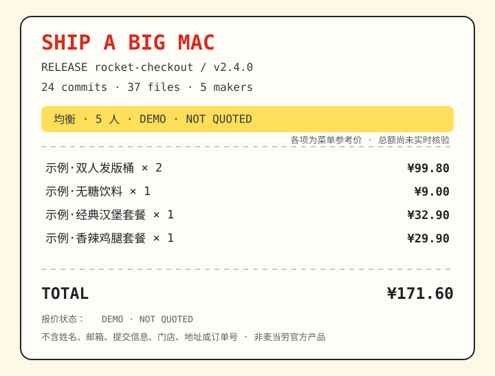

<div align="center">


# Ship a Big Mac｜发版就吃巨无霸

**读取本地 Git Release 的规模，用麦当劳中国官方 MCP 的当前门店菜单和整单核价，生成团队庆功餐与可分享的 Release 小票。**

[在线试玩](https://ddongdongdong.github.io/ship-a-big-mac/) · [30 秒 CLI Demo](#30-秒-demo无需-token) · [真实工作流](#真实工作流) · [安全边界](#安全边界) · [MCP 集成](MCP_INTEGRATION.md)

</div>

---

发版后的经典对话通常是：“几个人？”“预算多少？”“这家店现在卖什么？”“券到底能不能用？”

Ship a Big Mac 把它变成一条可核验的流水线：

```text
本地 Git 活动 → 庆祝规模 → 当前门店菜单 → 三套候选 → 每套 MCP 真实核价 → Release 小票
```

代码、提交标题和作者邮箱不会发送给麦当劳 MCP。MCP 只接收点餐所需的门店、商品与优惠参数。

## 30 秒 Demo（无需 Token）

需要 Python 3.9+，零第三方依赖：

```bash
git clone https://github.com/Ddongdongdong/ship-a-big-mac.git
cd ship-a-big-mac
python -m ship_a_big_mac demo
```

Demo 会打印三种庆功餐策略，并在当前目录生成 `release-receipt.svg`：

```text
SHIP A BIG MAC · SYNTHETIC DEMO
Release: rocket-checkout v2.4.0 · 24 commits

[均衡] 6 人份 · ¥171.60
  示例·双人发版桶 × 2       ¥99.80
  示例·无糖饮料 × 1          ¥9.00
  示例·经典汉堡套餐 × 1     ¥32.90
  示例·香辣鸡腿套餐 × 1     ¥29.90
  报价状态: MENU_SUM_NOT_MCP_QUOTED

[省预算] 6 人份 · ¥149.70
  示例·双人发版桶 × 3      ¥149.70
  报价状态: MENU_SUM_NOT_MCP_QUOTED
```

<p align="center"></p>

> Demo 中的名称、价格和商品编码均为虚构数据。真实模式只有经过 `calculate-price` 的结果才能标记为 MCP VERIFIED。

## 它解决什么

普通点餐助手从“想吃什么”开始；Ship a Big Mac 从“我们刚刚完成了什么”开始。

| 发版事实 | 庆祝决策 |
|---|---|
| 提交数、文件数、改动量 | hotfix / regular / major 庆祝强度 |
| 本地贡献者数量 | 默认建议用餐人数 |
| 用户预算 | 每个候选方案的硬上限 |
| 当前门店菜单 | 真正可买到的商品池 |
| `calculate-price` | 唯一的最终价格依据 |

它不读取源代码内容；默认也不公开贡献者姓名。分享卡只显示提交数、文件数、贡献者数量和餐品。

## 真实工作流

### 1. 安装

```bash
python -m pip install -e .
```

### 2. 在本机分析 Release

```bash
ship-a-big-mac analyze --repo /path/to/repository --days 14 --output release-context.json
```

默认贡献者会显示为匿名标签。只有你明确需要本机姓名输出时才使用 `--include-names`。

### 3. 配置官方 MCP

先到 <https://open.mcd.cn/mcp> 申请并妥善保存 Token，然后在支持 Streamable HTTP 的客户端中使用 [`mcp-config.example.json`](mcp-config.example.json)。真实 Token 只能放在本机环境变量：

```bash
export MCD_MCP_TOKEN='你的新 Token'
ship-a-big-mac mcp-tools
```

不要把 Token 写进 JSON、README、Issue、截图或 Git 历史。

### 4. 让 Agent 使用 Skill

将本仓库作为 Skill 加载，然后说：

> 我们刚发完 v2.4.0，5 个人，预算 180 元，在上海徐家汇附近到店取餐，帮我安排一桌发版庆功餐。

Agent 会按照 [`SKILL.md`](SKILL.md) 调用：

```text
now-time-info
→ query-nearby-stores
→ query-meals / query-meal-detail
→ query-store-coupons
→ calculate-price（每个候选分别核价）
```

本地规划器只负责在预算内产生候选，不把菜单价加总冒充实付价。真实金额以 `calculate-price` 返回为准。

### 5. 生成 MCP VERIFIED 小票

Agent 将 MCP 核价金额写入分享卡：

```bash
ship-a-big-mac receipt \
  --context release-context.json \
  --plan release-plan.json \
  --quoted-total 168.50 \
  --output release-receipt.svg
```

## 为什么不是另一个 Git 点餐工具

- Git 只是本地“庆祝规模传感器”，不是点餐命令皮肤。
- 核心对象是多人 Release Feast，而不是个人购物车。
- 核心产物是一张能复核报价来源、又不泄露代码和个人信息的 Release 小票。
- 默认只读、只规划、只核价；v0.1 不自动创建订单。

## 安全边界

- **凭据不落盘：** Token 仅从 `MCD_MCP_TOKEN` 读取。
- **价格不猜：** 未经过 `calculate-price` 的结果固定标记为 `MENU_SUM_NOT_MCP_QUOTED`。
- **Demo 强隔离：** fixture 文件名和输出均标记 `synthetic`，且不联网。
- **分享不泄密：** SVG 不包含源码、提交标题、作者邮箱、地址、门店、订单号或支付链接。
- **默认无写操作：** 不领券、不抽奖、不兑换积分、不建地址、不下单、不取消订单。

## 项目结构

```text
SKILL.md                         Agent 工作流与安全规则
MCP_INTEGRATION.md               MCP Tool、调用链和业务价值
mcp-config.example.json          脱敏连接示例
ship_a_big_mac/                  Git 分析、规划、协议客户端、SVG 渲染
ship_a_big_mac/data/*.synthetic.json  明确标记的虚构 Demo 数据
references/                      Skill 按需读取的实时流程与数据格式
tests/                           标准库 unittest 测试
CONTEST_DECLARATION.md           官方参赛声明原文
```

## 验证

```bash
python -m unittest discover -s tests -v
python -m ship_a_big_mac demo --output /tmp/release-receipt.svg
```

## 参赛信息

- 赛事：麦当劳程序员创意开发大赛
- 官方能力：麦当劳中国 MCP Server
- 项目 Owner：[@Ddongdongdong](https://github.com/Ddongdongdong)
- 状态：开发中；完成真实只读菜单与核价验收后再提交报名 Issue

本项目为非官方参赛作品。餐品、价格、优惠与供应状态以麦当劳官方实时结果为准。
