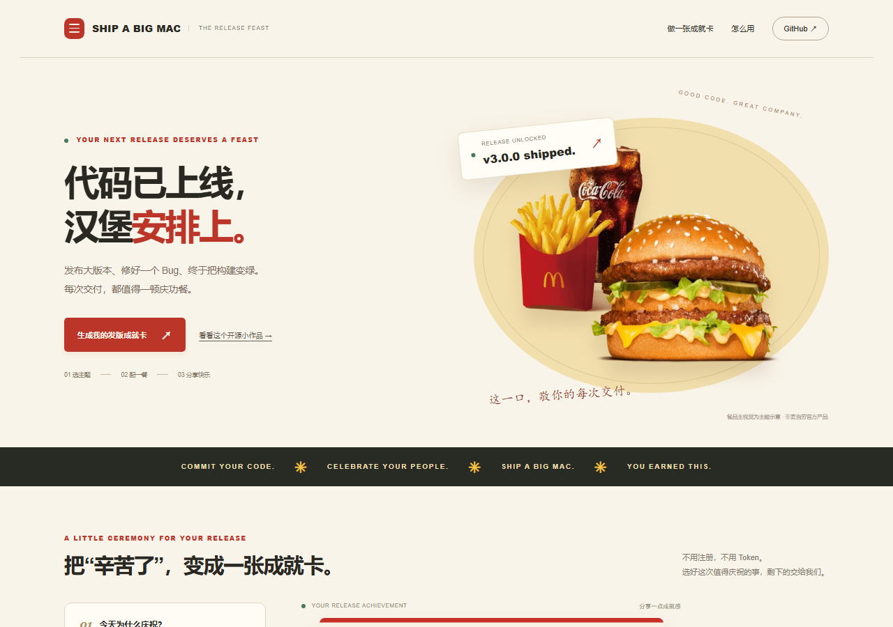
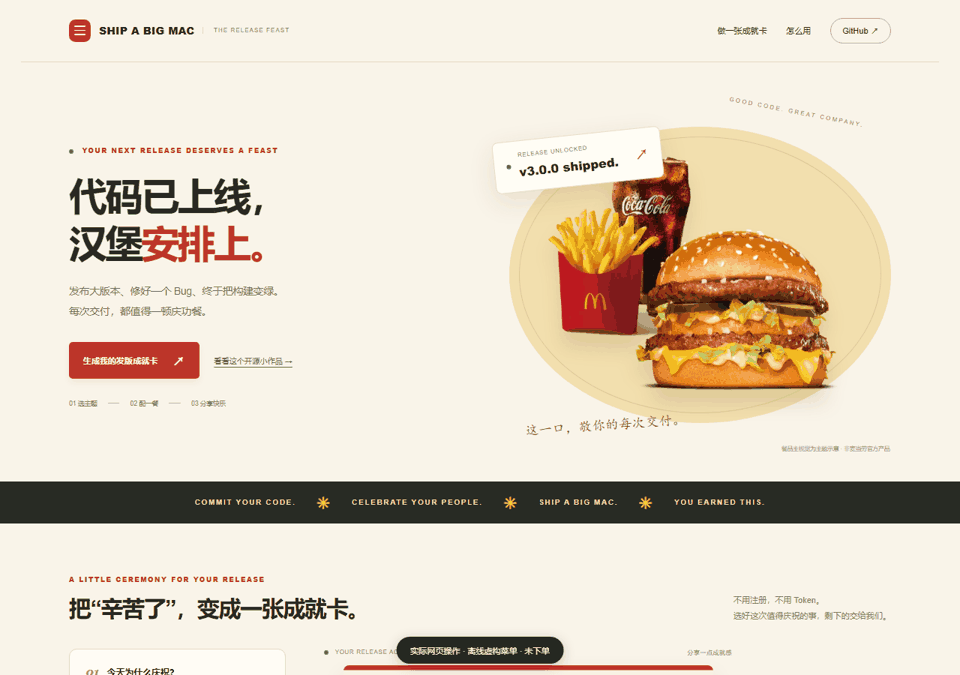
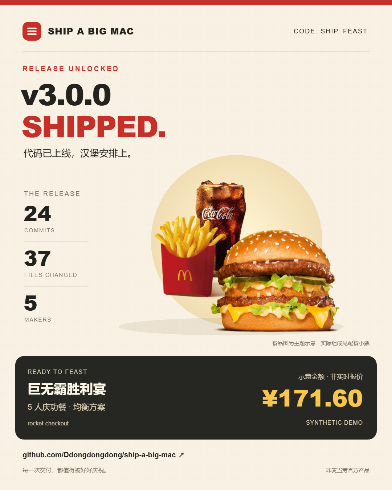

<div align="center">

# Ship a Big Mac 🍔

### 代码已上线，汉堡安排上。

**给刚发完版的自己和队友，一顿庆功餐、一张值得分享的成就卡。**

[在线试玩](https://ddongdongdong.github.io/ship-a-big-mac/) · [一键庆祝](#一键庆祝) · [真实核价记录](LIVE_VALIDATION.md) · [全部功能](references/capabilities.md)

[](https://github.com/Ddongdongdong/ship-a-big-mac/actions/workflows/tests.yml)
[](https://github.com/Ddongdongdong/ship-a-big-mac/releases/latest)
[](https://github.com/Ddongdongdong/ship-a-big-mac)

<a href="https://ddongdongdong.github.io/ship-a-big-mac/"></a>

如果你也觉得每一次交付都值得庆祝，欢迎试玩，喜欢就点一颗 ⭐。

</div>

发完一个大版本、修完一个救火 Hotfix，或者终于把红色构建变绿——不管只有 2 个提交还是 200 个，都值得说一句“辛苦了”。

选一个庆祝主题，确认人数和预算。Ship a Big Mac 把本地 Git 统计、庆功餐方案和专属成就卡放在同一个流程里；真实模式从麦当劳中国官方 MCP 读取门店菜单，再逐套核价。

| 这次完成了什么 | 你的庆祝主题 |
|---|---|
| Major Release | 巨无霸胜利宴 |
| Hotfix | 紧急回血套餐 |
| Sprint Complete | 团队能量补给 |
| Failed Build → Green | 绝地反击庆功餐 |

主题由你选。Git 统计记录这次交付，人数和预算决定怎么配餐。

## 30 秒，看它真的跑起来

<a href="https://ddongdongdong.github.io/ship-a-big-mac/"></a>

这段录制操作的是实际网页，使用离线虚构菜单；没有连接账户，也没有下单。[下载 30 秒 MP4](assets/celebrate-demo.mp4) · [WebM 原片](assets/celebrate-demo.webm)，可用于二次剪辑。

## 一键庆祝

需要 Git 和 Python 3.9+，运行时零第三方依赖：

```bash
git clone https://github.com/Ddongdongdong/ship-a-big-mac.git
cd ship-a-big-mac
python -m pip install -e .
ship-a-big-mac celebrate --demo
```

一次交互确认庆祝主题、人数和预算，选好方案后生成：

- **成就卡 SVG**：主题、版本号、commits / files / makers、金额和项目链接。
- **配餐小票 SVG**：餐品数量、参考价与最终金额来源。
- **本地 HTML 预览**：直接打开，下载 **1080 × 1350 PNG**，发给队友或放进 GitHub Release。

<p align="center"></p>

这是程序实际生成的成就卡。展示仓库与版本为示例；餐品图是庆祝主题示意，精确组成看配餐小票。[图片来源](assets/FOOD_CREDITS.md)。

### 用自己的仓库和真实门店

在 <https://open.mcd.cn/mcp> 申请 Token，放进本机环境变量 `MCD_MCP_TOKEN`，然后运行：

```bash
ship-a-big-mac celebrate
```

按照提示选择主题、人数、预算、城市和地标，程序完成：

```text
本地 Git 分析 → 选择取餐门店 → 当前菜单与套餐默认组成
           → 生成候选 → 逐套官方核价 → 选择方案 → 成就卡 + 小票
```

首版一键流程支持到店取餐，默认套餐组成。菜单价可能与整单核价不同；超预算或核价失败的候选会被淘汰。不会自动创建订单。优惠券会查询，但不会声称遍历了所有优惠组合。

`ship-a-big-mac celebrate --help` 查看参数，[一键庆祝指南](references/celebrate.md) 列出脚本用法、默认选择和当前支持的套餐范围。外送、定制套餐选项与个性化约束可使用 [Skill 工作流](SKILL.md) 和现有底层命令；一键流程暂不提供逐人口味分餐与过敏原保证。

Token 只从本机环境变量读取，不写进仓库、截图或分享卡。MCP 只接收点餐参数，本地源码、提交标题和作者邮箱不上传。

## 功能不止庆功餐

保留官方 MCP 的 **35 个工具入口**：28 个查询、7 个需要确认的账户操作。普通查询不要求你有 Git 仓库。

```bash
ship-a-big-mac features          # 查看全部能力
ship-a-big-mac nutrition         # 餐品营养
ship-a-big-mac calendar          # 当月活动
ship-a-big-mac available-coupons # 可领取的券
ship-a-big-mac coupons           # 我的券
ship-a-big-mac points            # 我的积分
ship-a-big-mac mall              # 积分商城
ship-a-big-mac orders            # 历史订单
ship-a-big-mac addresses         # 配送地址
```

领券、积分兑换、下单等操作先通过 `mcp-action` 查看具体预览，再用匹配的确认码执行。下单前重新核价，价格或参数变化会使原确认失效。[完整功能和参数指南](references/capabilities.md) · [MCP 接入说明](MCP_INTEGRATION.md) · [配置示例](mcp-config.example.json)。

## 金额有依据，分享有边界

真实验收曾得到 5 人方案 **¥171.00 / ¥167.50**；另一个方案菜单参考价 ¥163.50，官方整单价 ¥243.00，被 ¥180 预算拒绝。它们是单次历史结果，不是长期优惠承诺。[详细记录](LIVE_VALIDATION.md)。

| 输出状态 | 含义 |
|---|---|
| 示意金额 / SYNTHETIC DEMO | 虚构菜单演示，未实时核价 |
| USER REPORTED | 用户手填金额，未官方核验 |
| MCP VERIFIED | 当前调用获得官方核价，并通过商品、金额和预算校验 |

报价绑定门店、履约方式、套餐选项、优惠与预约上下文；这些参数改变时必须重新核价。分享卡仅显示仓库名、聚合工程统计和庆功信息，预览后再分享。核价不代表已下单，小票也不是官方付款凭证。

“省预算”表示选定菜单范围内的最低菜单价组合。我们生成预算内候选，再用官方 MCP 验证；不宣传全门店、全部优惠券组合的全局最低价。`serves` 仍是名义份数模型，不能据此断言每个人一定吃饱。

## 开发与验证

```bash
python -m unittest discover -s tests -v
python scripts/sync_demo_data.py --check
```

网页与 Python 共用一份合成菜单，Node 执行实际浏览器规划器，与 Python 对比 **1,620 组人数 / 预算 / 策略组合**和额外边界样例。CI 安装 Node 并持续验证；本机没有 Node 时只跳过该跨语言测试。

```text
ship_a_big_mac/celebrate.py     一键庆祝与真实取餐流程
ship_a_big_mac/planner.py       候选规划
ship_a_big_mac/quote.py         官方核价与上下文绑定
ship_a_big_mac/render.py        小票、成就卡、PNG 导出预览
ship_a_big_mac/themes.py        四种用户选择的庆祝场景
ship_a_big_mac/data/            共享示例菜单与餐品主视觉
docs/                          静态试玩站
scripts/                       数据同步与演示录制
tests/                         离线回归与跨语言一致性测试
```

## 参赛与反馈

个人开源作品，Owner：[@Ddongdongdong](https://github.com/Ddongdongdong)。[官方已确认报名成功](https://github.com/M-China/mcd-developer-innovation-challenge/issues/757#issuecomment-6190464611)。[首发图文与视频素材](LAUNCH_KIT.md)。欢迎提 Issue、分享你的发版卡，以及自愿 Star。

非麦当劳官方产品。实际餐品、价格、优惠与供应状态以官方实时返回为准。
